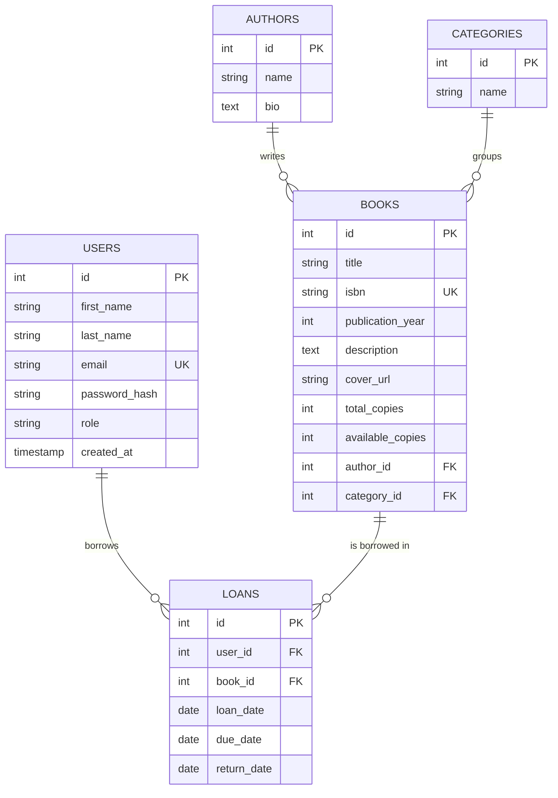

# Entity Relationship Diagram

## Entities

| Entity | Fields |
|---|---|
| users | id (PK), first_name, last_name, email (unique), password_hash, role, created_at |
| authors | id (PK), name, bio |
| categories | id (PK), name |
| books | id (PK), title, isbn (unique), publication_year, description, cover_url, total_copies, available_copies, author_id (FK), category_id (FK) |
| loans | id (PK), user_id (FK), book_id (FK), loan_date, due_date, return_date |

## Relationships

- authors 1 - N books
- categories 1 - N books
- users 1 - N loans
- books 1 - N loans

## Diagram

